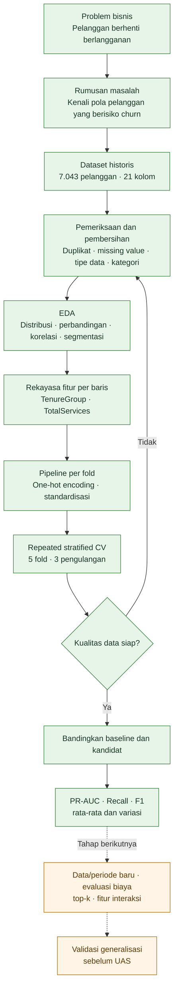
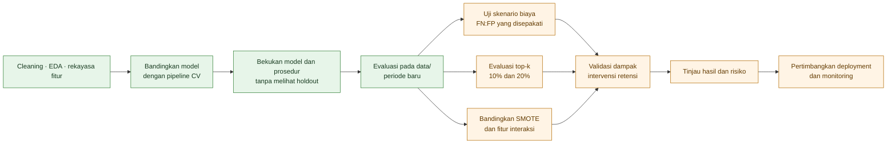

# Prediksi Churn Pelanggan Telekomunikasi

> Dalam proyek ini, kami mempelajari data pelanggan telekomunikasi untuk melihat pola yang berkaitan dengan churn. Kami memeriksa dan membersihkan data, melakukan EDA, membuat beberapa fitur, lalu membandingkan model klasifikasi awal. Hasilnya masih berupa eksperimen akademik, belum untuk digunakan langsung oleh perusahaan.

[Buka notebook di Google Colab](https://colab.research.google.com/github/carlos1739/analisis_telco/blob/master/notebook/churn_analysis.ipynb)

## Daftar Isi

1. [Project Overview](#1-project-overview)
2. [Dataset dan Data Dictionary](#8-dataset-dan-data-dictionary)
3. [Cleaning Data](#9-bagian-1--cleaning-data)
4. [EDA](#10-bagian-2--eda)
5. [Feature Engineering dan Eksperimen Model](#11-bagian-3--engineer-feature-engineering-dan-eksperimen-model)
6. [Menjalankan Notebook](#12-menjalankan-notebook)
7. [Validasi dan Rencana Evaluasi](#13-validation-dan-rencana-evaluasi)
8. [Kesimpulan dan Rekomendasi](#14-kesimpulan-dan-rekomendasi)
9. [Status Proyek dan Roadmap](#15-status-proyek-dan-roadmap)

---

## 1. Project Overview

Kami menggunakan dataset **Telco Customer Churn** untuk melihat karakteristik pelanggan yang berhenti berlangganan. Analisis ini diharapkan dapat menunjukkan kelompok yang menarik untuk diteliti lebih lanjut dan menjadi langkah awal dalam membandingkan model klasifikasi churn.

### Tujuan proyek

- Melihat perbandingan jumlah pelanggan yang churn dan tidak churn.
- Mencari karakteristik pelanggan yang tampak berkaitan dengan churn.
- Menyiapkan data dan fitur untuk mencoba beberapa model klasifikasi.
- Menentukan hal-hal yang masih perlu diuji pada tahap berikutnya.

### Ringkasan proyek

| Bagian | Keterangan |
|---|---|
| Topik | Churn pelanggan telekomunikasi |
| Jenis masalah | Klasifikasi biner dan eksplorasi data |
| Sumber data | IBM Sample Data Sets — Telco Customer Churn |
| Isi data | 7.043 pelanggan, 21 kolom |
| Target | `Churn` (`Yes` / `No`) |
| Notebook | `notebook/churn_analysis.ipynb` |
| Dataset | `data/Churn_Customer_telco.zip` |
| Model yang dibandingkan | Logistic Regression, KNN, Decision Tree, Random Forest, dan HistGradientBoosting |
| Evaluasi utama | Repeated stratified 5-fold CV, 3 pengulangan |
| Catatan | Hasil eksperimen lama pada test set bersifat eksploratif karena set tersebut telah digunakan berulang kali |
| Deployment | Tidak dikerjakan pada tahap ini |

---

## 2. Problem Statement

Pelanggan yang berhenti berlangganan dapat berdampak pada pendapatan perusahaan. Karena itu, perusahaan perlu memahami karakteristik pelanggan yang berhenti dan hal-hal yang mungkin berkaitan dengan keputusan tersebut. Dataset ini memberi kesempatan untuk mulai memeriksa pola-pola itu.

**Pertanyaan utama:** karakteristik demografi, layanan, kontrak, atau akun apa yang tampak berkaitan dengan churn? Kami juga ingin mengetahui bagaimana beberapa model klasifikasi awal bekerja pada dataset ini.

Satu baris mewakili satu pelanggan pada saat data dibuat. Dataset ini tidak mencantumkan urutan waktu maupun jangka waktu prediksi. Jadi, hasil analisis tidak dapat langsung dianggap sebagai prediksi siapa yang akan berhenti berlangganan di masa depan.

| Tantangan | Dampak |
|---|---|
| Churn baru diketahui setelah pelanggan berhenti | Kesempatan untuk melakukan tindak lanjut lebih awal menjadi terbatas |
| Jumlah pelanggan churn lebih kecil daripada pelanggan bertahan | Akurasi biasa dapat memberikan gambaran performa yang menyesatkan |
| Karakteristik pelanggan tersebar di banyak kolom | Dibutuhkan eksplorasi dan persiapan fitur sebelum modeling |
| Pola historis dapat disalahartikan sebagai penyebab | Temuan perlu dibaca sebagai asosiasi, bukan bukti sebab-akibat |

> Analisis ini tidak membuktikan bahwa suatu layanan, kontrak, atau metode pembayaran menyebabkan churn. Hasilnya merupakan pola pada dataset historis dan perlu divalidasi sebelum dipakai untuk keputusan pelanggan.

---

## 3. Stakeholders dan Target Pengguna

| Stakeholder | Kebutuhan |
|---|---|
| Tim retensi pelanggan | Mengetahui segmen yang perlu diteliti dan menguji intervensi yang relevan |
| Manajemen produk | Memahami hubungan layanan, kontrak, dan pengalaman pelanggan dengan churn |
| Data analyst | Mengeksplorasi dan menjelaskan pola churn dalam dataset |
| Data scientist / ML engineer | Menggunakan data yang telah dibersihkan sebagai dasar eksperimen model |

Hasil analisis dapat menjadi bahan untuk menentukan pertanyaan lanjutan, tetapi belum berupa sistem yang memberi skor risiko kepada pelanggan atau siap dipakai untuk mengambil tindakan.

---

## 4. Tujuan dan Analisis Saat Ini

### Tujuan analisis

1. Mengukur distribusi pelanggan churn dan tidak churn.
2. Membandingkan pola numerik dan kategorikal berdasarkan status churn.
3. Meninjau kombinasi segmen pelanggan yang memiliki churn lebih tinggi.
4. Memeriksa kualitas data, membandingkan model klasifikasi awal, dan mengeksplorasi trade-off precision-recall.

### Cakupan notebook yang sudah dikerjakan

Di notebook, kami melakukan pembersihan data, EDA, pembuatan fitur, lalu mencoba beberapa model classical machine learning. Pada bagian akhir, baseline dan kandidat dibandingkan menggunakan repeated stratified cross-validation. Encoding dan scaling dijalankan di dalam pipeline pada setiap fold.

Pada percobaan sebelumnya, test set yang sama digunakan beberapa kali untuk membandingkan model dan threshold. Karena itu, hasil tersebut kami anggap sebagai eksplorasi, bukan evaluasi akhir yang independen. Perbandingan terbaru menggunakan repeated stratified CV. Kami belum menguji model pada data dari periode lain atau menilai dampaknya jika dipakai dalam program retensi.

---

## 5. Application Scope

### Termasuk dalam proyek saat ini

- Dataset pelanggan berisi demografi, layanan, kontrak, pembayaran, dan target churn.
- Notebook untuk pembersihan data dan analisis eksploratif.
- Rekayasa fitur per baris dan eksperimen Logistic Regression, KNN, Decision Tree, Random Forest, serta HistGradientBoosting.
- Perbandingan repeated stratified cross-validation dengan preprocessing yang di-fit ulang pada setiap fold.
- Ringkasan temuan dan rekomendasi untuk analisis lanjutan.

### Belum termasuk dalam proyek saat ini

- Validasi performa pada periode/data baru dan penilaian kesiapan model untuk penggunaan operasional.
- Prediksi churn untuk pelanggan baru atau integrasi ke sistem perusahaan.
- Dashboard, REST API, aplikasi web, atau pipeline batch terjadwal.
- Eksperimen terkontrol untuk mengukur dampak program retensi.
- Deployment cloud, monitoring model, dan proses retraining.

| Area | Tanggung jawab proyek | Di luar cakupan saat ini |
|---|---|---|
| Data | Membersihkan dan mengeksplorasi dataset historis | Menjamin dataset mewakili kondisi pelanggan terkini |
| Analisis | Menjelaskan pola dan asosiasi yang ditemukan | Menyimpulkan sebab-akibat dari korelasi |
| Machine learning | Membandingkan baseline dan kandidat dengan pipeline repeated stratified cross-validation | Menganggap hasil test set lama independen atau menyatakan model siap operasional tanpa data/periode baru |
| Retensi | Memberi hipotesis segmen untuk diteliti | Menjamin intervensi tertentu akan mengurangi churn |

---

## 6. Analytical Architecture

Pekerjaan ini dilakukan di dalam notebook, bukan sebagai aplikasi. Dataset dimuat dan dibersihkan terlebih dahulu, kemudian kami melakukan EDA dan membandingkan beberapa model. Pada validasi silang, proses encoding dan scaling dipelajari dari data training di setiap fold agar informasi dari fold validasi tidak ikut digunakan.

### 6.1 Alur dari masalah hingga tindak lanjut



### 6.2 Alur data dan notebook

```mermaid
flowchart LR
    ZIP["data/Churn_Customer_telco.zip"] --> CSV["CSV Telco Customer Churn"]
    CSV --> LOAD["Muat dan inspeksi"]
    LOAD --> CLEAN["Pembersihan data"]
    CLEAN --> EDA["EDA dan analisis segmen"]
    EDA --> FEATURES["Fitur per baris<br/>TenureGroup · TotalServices"]
    FEATURES --> CV["Repeated stratified CV<br/>5 fold × 3 pengulangan"]
    CV --> PIPE["Pipeline di setiap fold<br/>encoding · scaling · model"]
    PIPE --> RESULTS["PR-AUC · Recall · F1<br/>mean ± standar deviasi"]
    RESULTS -.-> FUTURE["Evaluasi pada data/periode baru<br/>sebelum klaim generalisasi"]
```



---

## 7. Technology Stack

| Teknologi | Pemakaian |
|---|---|
| Python | Bahasa untuk analisis dan persiapan data |
| Jupyter Notebook | Menjalankan kode, visualisasi, dan narasi analisis |
| pandas | Membaca, membersihkan, dan memanipulasi data tabular |
| NumPy | Operasi numerik |
| Matplotlib | Visualisasi |
| Seaborn | Visualisasi statistik |
| SciPy | Uji statistik, termasuk Mann–Whitney |
| scikit-learn | Pembagian dataset, encoding/scaling, cross-validation, tuning, model klasifikasi, dan evaluasi |
| Google Colab | Opsi menjalankan notebook di browser |

Dependensi untuk menjalankan notebook dicatat di `requirement.txt`.

---

## 8. Dataset dan Data Dictionary

### 8.1 Sumber dan ukuran data

Dataset yang digunakan adalah **Telco Customer Churn** dari IBM Sample Data Sets. Arsip yang dipakai dalam proyek tersedia di [repositori proyek](https://github.com/carlos1739/analisis_telco/blob/master/data/Churn_Customer_telco.zip). Unit observasinya adalah satu baris per pelanggan pada satu snapshot; dataset tidak menyediakan deret waktu atau horizon prediksi.

| Properti | Nilai |
|---|---|
| Jumlah baris | 7.043 pelanggan |
| Kolom data mentah | 21 |
| Kolom setelah `customerID` dihapus | 20 |
| Target | `Churn` |
| Format arsip | ZIP berisi CSV |
| Nama CSV | `WA_Fn-UseC_-Telco-Customer-Churn.csv` |

### 8.2 Kelompok kolom

| Kelompok | Kolom | Deskripsi |
|---|---|---|
| Identitas | `customerID` | ID pelanggan untuk pemeriksaan duplikasi; tidak digunakan sebagai fitur |
| Demografi | `gender`, `SeniorCitizen`, `Partner`, `Dependents` | Informasi profil, status senior, pasangan, dan tanggungan |
| Masa berlangganan | `tenure` | Lama pelanggan berlangganan dalam bulan |
| Telepon | `PhoneService`, `MultipleLines` | Status layanan telepon dan lebih dari satu saluran |
| Internet dan layanan tambahan | `InternetService`, `OnlineSecurity`, `OnlineBackup`, `DeviceProtection`, `TechSupport`, `StreamingTV`, `StreamingMovies` | Jenis internet dan layanan tambahan yang digunakan |
| Kontrak dan pembayaran | `Contract`, `PaperlessBilling`, `PaymentMethod` | Jenis kontrak, tagihan tanpa kertas, dan metode pembayaran |
| Tagihan | `MonthlyCharges`, `TotalCharges` | Tagihan bulanan dan total tagihan pelanggan |
| Target | `Churn` | Label `Yes` (churn) atau `No` (tidak churn) |

### 8.3 Definisi target

| Nilai dataset | Makna | Encoding model |
|---|---|---:|
| `No` | Pelanggan tidak churn | `0` |
| `Yes` | Pelanggan churn | `1` |

---

## 9. Bagian 1 — Cleaning Data

Sebelum melihat pola churn, kami memeriksa duplikasi, nilai kosong, dan tipe data. Beberapa nilai juga dirapikan agar bisa digunakan dalam analisis.

### 9.1 Pemeriksaan dan transformasi data

- Tidak ditemukan duplikat `customerID` atau baris duplikat.
- Ditemukan **11 nilai kosong** pada `TotalCharges`; seluruhnya memiliki `tenure = 0`.
- `TotalCharges` dikonversi ke numerik dan nilai kosong tersebut diisi `0`, sesuai kondisi belum ada akumulasi tagihan.
- `customerID` dihapus sebagai kolom identitas, bukan fitur prediksi.
- Spasi pada nilai kategorikal dibersihkan.
- `No phone service` pada `MultipleLines` disatukan menjadi `No`.
- `No internet service` pada kolom layanan internet tambahan disatukan menjadi `No`.
- Tidak ada missing value tersisa setelah proses pembersihan pada data yang diperiksa notebook.

### 9.2 Hasil bagian Cleaning

| Pemeriksaan | Hasil |
|---|---|
| Baris duplikat | 0 |
| Duplikat `customerID` | 0 |
| `TotalCharges` kosong sebelum dibersihkan | 11, semuanya pada `tenure = 0` |
| `TotalCharges` kosong setelah dibersihkan | 0 |
| Missing value setelah pembersihan | 0 |
| Kolom data setelah `customerID` dibuang | 20 |

---

## 10. Bagian 2 — EDA

Pada EDA, kami melihat jumlah pelanggan yang churn, lalu membandingkan beberapa karakteristik pelanggan berdasarkan status churn.

### 10.1 Distribusi churn

| Status | Jumlah | Proporsi |
|---|---:|---:|
| Tidak churn | 5.174 | 73,5% |
| Churn | 1.869 | 26,5% |

Jumlah pelanggan yang churn lebih sedikit daripada yang tidak churn: kira-kira satu dari empat pelanggan tercatat churn. Jika model selalu menebak “tidak churn”, akurasinya tetap sekitar **73,5%**, tetapi model sama sekali tidak menemukan pelanggan churn. Karena itu, kami juga melihat metrik selain akurasi.

### 10.2 Perbandingan fitur numerik

| Fitur | Churn | Tidak churn | Pola yang terlihat |
|---|---:|---:|---|
| `tenure` — rata-rata | 18,0 bulan | 37,6 bulan | Pelanggan churn cenderung memiliki masa berlangganan lebih pendek |
| `tenure` — median | 10 bulan | 38 bulan | Distribusi masa berlangganan berbeda |
| `MonthlyCharges` — rata-rata | 74,4 | 61,3 | Tagihan bulanan pelanggan churn cenderung lebih tinggi |
| `TotalCharges` — rata-rata | 1.531,8 | 2.549,9 | Nilai lebih rendah sejalan dengan masa berlangganan yang lebih pendek |

Uji Mann–Whitney pada notebook menunjukkan perbedaan yang signifikan secara statistik untuk ketiga fitur numerik tersebut. Pemeriksaan dengan aturan IQR tidak menandai nilai yang perlu dihapus sebagai outlier.

### 10.3 Asosiasi kategorikal dan segmen

| Faktor/segmen | Tingkat churn atau asosiasi yang dilaporkan |
|---|---:|
| Kontrak *month-to-month* | 42,7% |
| Kontrak dua tahun | 2,8% |
| Layanan *fiber optic* | 41,9% |
| Layanan DSL | 19,0% |
| Tanpa layanan internet | 7,4% |
| Pembayaran *electronic check* | 45,3% |
| Tanpa `OnlineSecurity` atau `TechSupport` | Sekitar 31% |
| Memiliki `OnlineSecurity` atau `TechSupport` | Sekitar 15% |
| Segmen *month-to-month* + *fiber optic* | 54,6% |

Berdasarkan Cramér’s V, `Contract`, `InternetService`, dan `PaymentMethod` memiliki asosiasi paling kuat dengan target di antara fitur kategorikal yang diperiksa. Perlu diperhatikan bahwa nilai `No` pada kolom layanan tambahan juga dapat berarti pelanggan tidak menggunakan internet. Karena itu, kolom-kolom tersebut sebaiknya dibaca bersama `InternetService`.

### 10.4 Masa berlangganan dan korelasi

| Kelompok `tenure` | Tingkat churn |
|---|---:|
| 0–12 bulan | 47,4% |
| 13–24 bulan | 28,7% |
| 25–48 bulan | 20,4% |
| 49–72 bulan | 9,5% |

`tenure` berkorelasi negatif dengan churn (-0,35). `TotalCharges` berkorelasi kuat dengan `tenure` (0,83) dan hampir identik dengan `tenure × MonthlyCharges` (korelasi 1,0). Hubungan ini perlu ditinjau saat pemilihan fitur, terutama untuk model yang sensitif terhadap multikolinearitas.

> Angka-angka ini berasal dari dataset historis yang dianalisis di notebook. Pola yang terlihat tidak membuktikan sebab-akibat dan belum menunjukkan apakah suatu program retensi akan berhasil.

---

## 11. Bagian 3 — Engineer: Feature Engineering dan Eksperimen Model

Setelah EDA, kami menyiapkan fitur dan target untuk percobaan klasifikasi.

### 11.1 Fitur turunan

| Fitur | Cara pembentukan | Keterangan |
|---|---|---|
| `TenureGroup` | Mengelompokkan `tenure` menjadi 0–1 tahun, 1–2 tahun, 2–4 tahun, dan lebih dari 4 tahun | Menyediakan kelompok masa berlangganan untuk analisis/model |
| `TotalServices` | Menghitung jumlah nilai `Yes` di delapan kolom layanan | Menggambarkan jumlah layanan yang digunakan |
| `Churn` numerik | `Yes` menjadi `1`, `No` menjadi `0` | Variabel target klasifikasi |

### 11.2 Fitur awal dan preprocessing

`TenureGroup` merangkum lama berlangganan ke dalam beberapa rentang, sedangkan `TotalServices` menunjukkan jumlah layanan yang digunakan pelanggan. Keduanya dibuat tanpa menggunakan target. Kami juga mempertahankan `gender` dalam perbandingan akhir. Memilih fitur berdasarkan hubungannya dengan target dari seluruh data sebelum validasi bisa membocorkan informasi ke evaluasi.

Kolom kategori diubah dengan one-hot encoding, sementara fitur numerik distandardisasi. Kedua langkah ini ada di dalam `Pipeline`, sehingga encoder dan scaler hanya belajar dari data training pada masing-masing fold. Kategori yang tidak muncul di data training ditangani dengan `handle_unknown='ignore'`.

### 11.3 Baseline, kandidat, dan desain evaluasi

Kami membandingkan baseline mayoritas dengan Logistic Regression, KNN, Decision Tree, Random Forest, dan HistGradientBoosting. Parameter model ditentukan sebelum evaluasi. Pada tahap ini, kami belum melakukan tuning hyperparameter atau memilih threshold.

Evaluasi menggunakan repeated stratified 5-fold CV dengan tiga pengulangan, sehingga proporsi kelas churn dijaga di setiap fold. Kami mencatat rata-rata dan standar deviasi Accuracy, Precision, Recall, F1, dan PR-AUC. PR-AUC menjadi metrik utama karena jumlah kelas churn lebih sedikit; Recall dan F1 membantu melihat seberapa baik model mengenali pelanggan churn.

### 11.4 Status hasil dan batas evaluasi

Tabel berikut berasal dari sel **Validasi Eksperimen Milestone 1** pada notebook dan dapat dihitung ulang dari kode yang dikumpulkan.

| Model | Accuracy (mean ± SD) | Precision (mean ± SD) | Recall (mean ± SD) | F1 (mean ± SD) | PR-AUC (mean ± SD) |
|---|---:|---:|---:|---:|---:|
| Baseline mayoritas | 0,735 ± 0,000 | 0,000 ± 0,000 | 0,000 ± 0,000 | 0,000 ± 0,000 | 0,265 ± 0,000 |
| Logistic Regression | 0,804 ± 0,007 | 0,665 ± 0,018 | 0,531 ± 0,020 | 0,590 ± 0,016 | 0,660 ± 0,018 |
| KNN | 0,777 ± 0,012 | 0,587 ± 0,025 | 0,536 ± 0,029 | 0,560 ± 0,024 | 0,576 ± 0,015 |
| Decision Tree | 0,739 ± 0,013 | 0,506 ± 0,016 | 0,798 ± 0,031 | 0,619 ± 0,012 | 0,613 ± 0,019 |
| Random Forest | 0,765 ± 0,009 | 0,541 ± 0,013 | 0,763 ± 0,028 | 0,633 ± 0,015 | 0,662 ± 0,019 |
| HistGradientBoosting | 0,800 ± 0,008 | 0,651 ± 0,019 | 0,529 ± 0,029 | 0,583 ± 0,021 | 0,655 ± 0,019 |

Random Forest memperoleh PR-AUC rata-rata tertinggi, yaitu 0,662. Hasil Logistic Regression hampir sama, yaitu 0,660, sehingga belum cukup alasan untuk menyatakan Random Forest jelas lebih baik. Random Forest memiliki Recall lebih tinggi dan Precision lebih rendah. Decision Tree memperoleh Recall tertinggi, tetapi PR-AUC-nya lebih rendah. Baseline mayoritas menunjukkan lagi bahwa Accuracy 0,735 saja tidak berarti model mampu mengenali churn. Untuk saat ini, kami belum memilih model final.

Nilai SD menunjukkan perubahan hasil antar-fold, bukan interval kepercayaan yang independen, karena fold pada repeated CV saling berkaitan. Model masih menggunakan parameter awal; tuning dan pemilihan threshold belum dilakukan.

Test set dari percobaan terdahulu sudah digunakan berulang kali, jadi hasilnya tidak kami anggap sebagai holdout independen. Untuk UAS, kami perlu menguji model pada data atau periode baru. Jika data baru tidak tersedia, holdout perlu ditentukan sebelum eksperimen berikutnya dimulai dan tidak digunakan untuk memilih model. Dataset ini hanya berisi satu snapshot dan tidak menyebutkan horizon prediksi.

---

## 12. Menjalankan Notebook

### Opsi A — Google Colab

Buka [notebook di Google Colab](https://colab.research.google.com/github/carlos1739/analisis_telco/blob/master/notebook/churn_analysis.ipynb), lalu jalankan sel dari atas ke bawah. Notebook akan mencoba mengunduh arsip dataset dari repositori jika file belum tersedia, jadi Colab perlu terhubung ke internet.

### Opsi B — Lokal di Windows

Gunakan Python 3.11 atau 3.12, lalu jalankan perintah berikut dari root repositori melalui PowerShell:

```powershell
python -m venv .venv
.\.venv\Scripts\Activate.ps1
python -m pip install --upgrade pip
python -m pip install -r requirement.txt
jupyter lab
```

Di JupyterLab, buka `notebook/churn_analysis.ipynb` dan jalankan sel dari atas ke bawah. Kode modeling lama masih ada sebagai catatan percobaan. Untuk membandingkan model, gunakan tabel pada bagian **Validasi Eksperimen Milestone 1**.

Jika PowerShell menolak aktivasi virtual environment, jalankan sesi PowerShell dengan kebijakan yang mengizinkan skrip aktivasi untuk pengguna atau gunakan interpreter `.venv\Scripts\python.exe` secara langsung.

### Lokasi dataset yang diharapkan notebook

Notebook menggunakan folder kerja `datasets/`. Jika menjalankan tanpa mengunduh arsip, siapkan file seperti berikut:

```text
analisis_telco/
└── datasets/
    ├── Churn_Customer_telco.zip
    └── WA_Fn-UseC_-Telco-Customer-Churn.csv
```

Kode akan mengekstrak CSV dari ZIP apabila CSV belum ada. Arsip versi repositori berada di `data/Churn_Customer_telco.zip`.

### Struktur repositori

```text
analisis_telco/
├── data/
│   └── Churn_Customer_telco.zip
├── notebook/
│   └── churn_analysis.ipynb
├── requirement.txt
└── README.md
```

---

## 13. Validation dan Rencana Evaluasi

### Validasi yang sudah dilakukan di notebook

| Pemeriksaan | Hasil |
|---|---|
| Duplikat ID dan baris | Tidak ditemukan |
| Missing `TotalCharges` | 11 nilai; seluruhnya pada `tenure = 0`, diisi `0` |
| Missing setelah pembersihan | 0 |
| Dimensi data mentah | 7.043 × 21 |
| Fitur turunan | `TenureGroup` dan `TotalServices`, dibuat tanpa target |
| Preprocessing CV | One-hot encoding dan scaling berada dalam `Pipeline`, di-fit hanya pada training fold |
| Evaluasi utama | Repeated stratified 5-fold CV, 3 pengulangan |
| Metrik | Accuracy, Precision, Recall, F1, dan PR-AUC; mean dan standar deviasi |
| Kandidat | Baseline mayoritas, Logistic Regression, KNN, Decision Tree, Random Forest, HistGradientBoosting |
| Test set lama | Pernah dipakai berulang; hasilnya ditandai eksplorasi dan tidak dilaporkan sebagai evaluasi independen |

### Langkah analisis berikutnya

| Langkah | Tujuan |
|---|---|
| Skenario biaya | Karena biaya sebenarnya tidak tersedia, bandingkan churn terlewat yang dianggap 1, 3, dan 5 kali lebih mahal daripada salah tandai; gunakan `MonthlyCharges` hanya sebagai proksi kasar nilai pelanggan |
| Holdout/data baru | Bekukan data atau periode baru sebelum eksperimen final untuk mengukur generalisasi |
| Evaluasi threshold/top-k | Tentukan biaya dan kapasitas retensi terlebih dahulu; pilih threshold atau top-k hanya dari data training/validasi, lalu evaluasi sekali pada holdout |
| Resampling dan fitur turunan | Bandingkan `class_weight` dengan SMOTE yang berada di dalam pipeline training; uji interaksi `Contract × InternetService` |
| Batas generalisasi | Dataset hanya satu snapshot; validasi pada periode atau perusahaan lain belum tersedia |

### Rencana kerja setelah UTS menuju UAS

| Urutan | Pekerjaan | Luaran/keputusan |
|---|---|---|
| 1 | Jalankan ulang notebook dari awal, tinjau pipeline, dan catat hasil CV beserta versi dependensi | Notebook dan tabel eksperimen yang dapat direproduksi |
| 2 | Tetapkan kriteria biaya churn terlewat, salah tandai, dan kapasitas retensi bersama dosen/tim | Asumsi evaluasi threshold atau top-k yang disepakati; jangan mengasumsikan biaya yang belum diketahui |
| 3 | Uji satu perubahan pada satu waktu: `class_weight`/SMOTE di dalam pipeline, lalu fitur interaksi `Contract × InternetService` | Catatan eksperimen yang membandingkan hasil pada CV tanpa menyentuh holdout |
| 4 | Jika tersedia, kumpulkan data periode berikutnya; bekukan sebagai holdout sebelum pemilihan model dan threshold | Evaluasi generalisasi pada data yang belum digunakan |

Hasil CV ini masih merupakan gambaran awal dari dataset yang tersedia. Hasil tersebut belum cukup untuk menyatakan model siap digunakan pada pelanggan sebenarnya.

---

## 14. Kesimpulan dan Rekomendasi

### Kesimpulan sementara

Secara umum, churn lebih banyak ditemukan pada pelanggan dengan masa berlangganan pendek, kontrak *month-to-month*, layanan *fiber optic*, dan pembayaran *electronic check*. Churn juga lebih jarang pada kelompok yang sudah berlangganan lebih lama. Temuan ini bisa menjadi arah untuk analisis berikutnya, tetapi tidak menunjukkan bahwa faktor-faktor tersebut menjadi penyebab churn.

### Rekomendasi

1. Periksa pengalaman pelanggan baru, khususnya selama 12 bulan pertama.
2. Analisis lebih lanjut segmen kontrak *month-to-month* dan pelanggan *fiber optic*, sambil mempertimbangkan karakteristik layanan dan tagihan.
3. Teliti alasan operasional atau pengalaman pelanggan yang mungkin berkaitan dengan *electronic check* sebelum merancang intervensi.
4. Biaya intervensi dan kuota tindakan tidak tersedia pada dataset publik. Sebagai analisis sensitivitas, bandingkan skenario biaya churn yang terlewat sebesar 1, 3, dan 5 kali biaya salah tandai; `MonthlyCharges` hanya proksi kasar nilai pelanggan, bukan nilai retensi aktual.
5. Ukur Precision dan Recall pada *top-k* 10% dan 20% pelanggan berisiko tertinggi untuk menilai pemeringkatan model.
6. Bandingkan `class_weight` dengan SMOTE yang diterapkan hanya pada data train, dan uji fitur turunan seperti interaksi `Contract × InternetService`.
7. Gunakan tabel CV terbaru pada notebook sebagai baseline eksperimen; jangan mengutip angka test lama sebagai hasil independen. Dataset hanya satu potret waktu, jadi hasil belum menunjukkan generalisasi ke periode atau perusahaan lain.

---

## 15. Status Proyek dan Roadmap

| Tahap | Status | Hasil |
|---|---|---|
| Pemuatan dan inspeksi data | Selesai | Dataset dimuat; ukuran dan tipe data diperiksa |
| Pembersihan data | Selesai | Nilai tagihan dibersihkan; kategori dinormalisasi |
| Exploratory Data Analysis | Selesai | Distribusi, perbandingan, korelasi, dan segmen dianalisis |
| Feature engineering | Selesai | `TenureGroup`, `TotalServices`, target biner |
| Desain evaluasi utama | Selesai untuk Milestone 1 | Repeated stratified 5-fold CV (3 pengulangan) dengan preprocessing di dalam pipeline |
| Perbandingan baseline dan kandidat | Selesai untuk Milestone 1 | Tabel mean ± standar deviasi dibuat oleh sel CV notebook; model belum ditetapkan sebagai final |
| Test set/threshold lama | Eksplorasi saja | Split lama telah digunakan berulang dan tidak dianggap holdout independen |
| Data/periode holdout baru | Rencana pasca-UTS | Bekukan sebelum eksperimen final untuk mengukur generalisasi |
| Analisis sensitivitas biaya | Rekomendasi notebook | Bandingkan rasio biaya FN:FP setelah asumsi biaya disetujui; `MonthlyCharges` hanya proksi kasar |
| Evaluasi strategi top-k | Rekomendasi notebook | Hitung Precision dan Recall pada 10% dan 20% teratas dengan holdout yang belum digunakan |
| Resampling dan fitur turunan | Rekomendasi notebook | Bandingkan SMOTE pada train dengan `class_weight`; uji interaksi `Contract × InternetService` |
| Batas generalisasi | Keterbatasan data | Dataset satu potret waktu; belum diuji pada periode/perusahaan lain |
| Validasi intervensi retensi | Di luar analisis notebook | Biaya, kuota, dan dampak intervensi tidak tersedia pada dataset publik |
| Deployment dan monitoring | Di luar cakupan saat ini | Pertimbangkan setelah model dan proses validasi tersedia |

### Roadmap lanjutan



---
