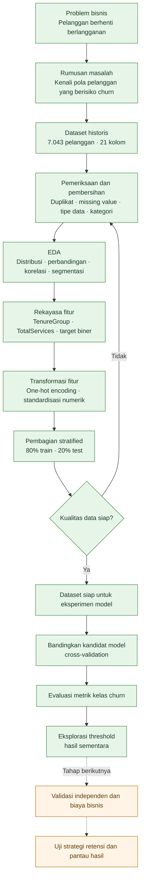
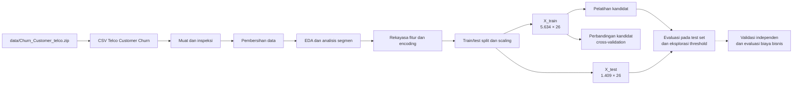
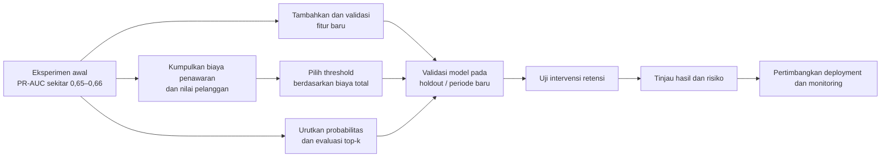

# Prediksi Churn Pelanggan Telekomunikasi

> Proyek analisis data pelanggan telekomunikasi untuk memahami pola churn dan menguji model klasifikasi awal. Notebook mencakup pemeriksaan data, EDA, rekayasa fitur, perbandingan model, cross-validation, serta eksplorasi threshold. Hasil masih bersifat eksperimen dan belum siap untuk penggunaan operasional.

[Buka notebook di Google Colab](https://colab.research.google.com/github/carlos1739/analisis_telco/blob/master/notebook/churn_analysis.ipynb)

## Daftar Isi

1. [Project Overview](#1-project-overview)
2. [Dataset dan Data Dictionary](#8-dataset-dan-data-dictionary)
3. [Cleaning Data](#9-bagian-1--cleaning-data)
4. [EDA](#10-bagian-2--eda)
5. [Feature Engineering dan Eksperimen Model](#11-bagian-3--engineer-feature-engineering-dan-eksperimen-model)
6. [Menjalankan Notebook](#12-menjalankan-notebook)
7. [Validasi dan Rencana Evaluasi](#13-validation-dan-rencana-evaluasi)
8. [Kesimpulan dan Rekomendasi](#14-kesimpulan-dan-rekomendasi)
9. [Status Proyek dan Roadmap](#15-status-proyek-dan-roadmap)

---

## 1. Project Overview

Proyek ini menggunakan dataset **Telco Customer Churn** untuk mengeksplorasi karakteristik pelanggan yang berhenti berlangganan. Tujuan akhirnya adalah membantu memahami kelompok pelanggan yang perlu diperhatikan dan menyediakan fondasi data untuk model klasifikasi churn.

### Main Goal

- Memahami distribusi churn dan karakteristik pelanggan.
- Mengidentifikasi fitur dan segmen yang berasosiasi dengan churn.
- Membersihkan data dan membentuk fitur yang siap digunakan untuk eksperimen klasifikasi.
- Merumuskan tindak lanjut analisis yang dapat divalidasi oleh tim retensi.

### Project Snapshot

| Area | Implementasi saat ini |
|---|---|
| Domain | Analitik pelanggan telekomunikasi |
| Tipe analisis | Eksplorasi data, persiapan fitur, dan eksperimen klasifikasi biner |
| Sumber data | IBM Sample Data Sets — Telco Customer Churn |
| Data mentah | 7.043 pelanggan dan 21 kolom |
| Target | `Churn` (`Yes` / `No`) |
| Notebook | `notebook/churn_analysis.ipynb` — Cleaning, EDA, Engineer, dan eksperimen model |
| Dataset lokal | `data/Churn_Customer_telco.zip` |
| Model yang diuji | Logistic Regression, KNN, Decision Tree, Random Forest, dan HistGradientBoosting |
| Hasil sementara | HistGradientBoosting, threshold 0,37: recall 0,877 dan precision 0,461 pada test set |
| Deployment | Belum termasuk dalam proyek saat ini |

---

## 2. Problem Statement

Perusahaan telekomunikasi perlu mempertahankan pelanggan yang sudah ada. Jika pelanggan yang berisiko berhenti berlangganan tidak diketahui lebih awal, perusahaan kehilangan peluang untuk memahami masalah layanan atau menguji intervensi retensi yang tepat.

**Pertanyaan utama:** pola apa pada demografi, layanan, kontrak, dan informasi akun yang berhubungan dengan churn, serta bagaimana data historis dapat disiapkan untuk memprediksi pelanggan yang mungkin churn?

| Tantangan | Dampak |
|---|---|
| Churn baru diketahui setelah pelanggan berhenti | Kesempatan untuk melakukan tindak lanjut lebih awal menjadi terbatas |
| Jumlah pelanggan churn lebih kecil daripada pelanggan bertahan | Akurasi biasa dapat memberikan gambaran performa yang menyesatkan |
| Karakteristik pelanggan tersebar di banyak kolom | Dibutuhkan eksplorasi dan persiapan fitur sebelum modeling |
| Pola historis dapat disalahartikan sebagai penyebab | Temuan perlu dibaca sebagai asosiasi, bukan bukti sebab-akibat |

> Analisis ini tidak membuktikan bahwa suatu layanan, kontrak, atau metode pembayaran menyebabkan churn. Hasilnya merupakan pola pada dataset historis dan perlu divalidasi sebelum dipakai untuk keputusan pelanggan.

---

## 3. Stakeholders dan Target Pengguna

| Stakeholder | Kebutuhan |
|---|---|
| Tim retensi pelanggan | Mengetahui segmen yang perlu diteliti dan menguji intervensi yang relevan |
| Manajemen produk | Memahami hubungan layanan, kontrak, dan pengalaman pelanggan dengan churn |
| Data analyst | Mengeksplorasi dan menjelaskan pola churn dalam dataset |
| Data scientist / ML engineer | Menggunakan data yang telah dibersihkan sebagai dasar eksperimen model |

Analisis ditujukan untuk mendukung penyelidikan dan perencanaan tindak lanjut. Notebook belum menghasilkan sistem penilaian risiko pelanggan untuk penggunaan operasional.

---

## 4. Tujuan dan Analisis Saat Ini

### Tujuan analisis

1. Mengukur distribusi pelanggan churn dan tidak churn.
2. Membandingkan pola numerik dan kategorikal berdasarkan status churn.
3. Meninjau kombinasi segmen pelanggan yang memiliki churn lebih tinggi.
4. Memeriksa kualitas data, membandingkan model klasifikasi awal, dan mengeksplorasi trade-off precision-recall.

### Cakupan notebook yang sudah dikerjakan

Notebook mencakup **Cleaning Data**, **EDA**, dan **Engineer** (feature engineering serta persiapan data), dilanjutkan eksperimen model. Beberapa model dibandingkan menggunakan cross-validation dan metrik kelas churn; threshold juga dieksplorasi melalui precision-recall curve.

Eksperimen ini belum menghasilkan model yang tervalidasi secara independen untuk penggunaan operasional. Notebook belum mencakup deployment, monitoring, atau pengujian dampak intervensi retensi.

---

## 5. Application Scope

### Termasuk dalam proyek saat ini

- Dataset pelanggan berisi demografi, layanan, kontrak, pembayaran, dan target churn.
- Notebook untuk pembersihan data dan analisis eksploratif.
- Persiapan fitur, pemisahan data train/test, dan eksperimen Logistic Regression, KNN, Decision Tree, Random Forest, serta HistGradientBoosting.
- Perbandingan cross-validation, evaluasi metrik kelas churn, dan eksplorasi threshold.
- Ringkasan temuan dan rekomendasi untuk analisis lanjutan.

### Belum termasuk dalam proyek saat ini

- Validasi independen/final atas model dan threshold terpilih untuk memperkirakan performa di penggunaan nyata.
- Prediksi churn untuk pelanggan baru atau integrasi ke sistem perusahaan.
- Dashboard, REST API, aplikasi web, atau pipeline batch terjadwal.
- Eksperimen terkontrol untuk mengukur dampak program retensi.
- Deployment cloud, monitoring model, dan proses retraining.

| Area | Tanggung jawab proyek | Di luar cakupan saat ini |
|---|---|---|
| Data | Membersihkan dan mengeksplorasi dataset historis | Menjamin dataset mewakili kondisi pelanggan terkini |
| Analisis | Menjelaskan pola dan asosiasi yang ditemukan | Menyimpulkan sebab-akibat dari korelasi |
| Machine learning | Melatih dan membandingkan kandidat model secara eksperimen | Menyatakan model/threshold siap operasional tanpa validasi independen |
| Retensi | Memberi hipotesis segmen untuk diteliti | Menjamin intervensi tertentu akan mengurangi churn |

---

## 6. Analytical Architecture

Proyek ini merupakan alur analisis notebook, bukan aplikasi multi-service. Arsip dataset dimuat ke notebook, dibersihkan dan dianalisis, lalu fitur dibagi menjadi train dan test untuk eksperimen kandidat model, cross-validation, serta eksplorasi threshold.

### 6.1 Alur dari masalah hingga tindak lanjut



### 6.2 Alur data dan notebook



---

## 7. Technology Stack

| Teknologi | Pemakaian |
|---|---|
| Python | Bahasa untuk analisis dan persiapan data |
| Jupyter Notebook | Menjalankan kode, visualisasi, dan narasi analisis |
| pandas | Membaca, membersihkan, dan memanipulasi data tabular |
| NumPy | Operasi numerik |
| Matplotlib | Visualisasi |
| Seaborn | Visualisasi statistik |
| SciPy | Uji statistik, termasuk Mann–Whitney |
| scikit-learn | Pembagian dataset, encoding/scaling, cross-validation, tuning, model klasifikasi, dan evaluasi |
| Google Colab | Opsi menjalankan notebook di browser |

> File `requirement.txt` saat ini belum mendeklarasikan dependensi. Daftar instalasi untuk menjalankan notebook secara lokal dicantumkan pada bagian 12.

---

## 8. Dataset dan Data Dictionary

### 8.1 Sumber dan ukuran data

Dataset yang digunakan adalah **Telco Customer Churn** dari IBM Sample Data Sets dan tersedia pada repositori sebagai `data/Churn_Customer_telco.zip`.

| Properti | Nilai |
|---|---|
| Jumlah baris | 7.043 pelanggan |
| Kolom data mentah | 21 |
| Kolom setelah `customerID` dihapus | 20 |
| Target | `Churn` |
| Format arsip | ZIP berisi CSV |
| Nama CSV | `WA_Fn-UseC_-Telco-Customer-Churn.csv` |

### 8.2 Kelompok kolom

| Kelompok | Kolom |
|---|---|
| Identitas | `customerID` — diperiksa untuk duplikat, kemudian dihapus sebelum modeling |
| Demografi | `gender`, `SeniorCitizen`, `Partner`, `Dependents` |
| Masa berlangganan | `tenure` |
| Telepon | `PhoneService`, `MultipleLines` |
| Internet dan layanan tambahan | `InternetService`, `OnlineSecurity`, `OnlineBackup`, `DeviceProtection`, `TechSupport`, `StreamingTV`, `StreamingMovies` |
| Kontrak dan pembayaran | `Contract`, `PaperlessBilling`, `PaymentMethod` |
| Tagihan | `MonthlyCharges`, `TotalCharges` |
| Target | `Churn` |

### 8.3 Definisi target

| Nilai dataset | Makna | Encoding model |
|---|---|---:|
| `No` | Pelanggan tidak churn | `0` |
| `Yes` | Pelanggan churn | `1` |

---

## 9. Bagian 1 — Cleaning Data

Bagian ini memuat pemeriksaan kualitas dan pembersihan dataset sebelum analisis eksploratif.

### 9.1 Pemeriksaan dan transformasi data

- Tidak ditemukan duplikat `customerID` atau baris duplikat.
- Ditemukan **11 nilai kosong** pada `TotalCharges`; seluruhnya memiliki `tenure = 0`.
- `TotalCharges` dikonversi ke numerik dan nilai kosong tersebut diisi `0`, sesuai kondisi belum ada akumulasi tagihan.
- `customerID` dihapus sebagai kolom identitas, bukan fitur prediksi.
- Spasi pada nilai kategorikal dibersihkan.
- `No phone service` pada `MultipleLines` disatukan menjadi `No`.
- `No internet service` pada kolom layanan internet tambahan disatukan menjadi `No`.
- Tidak ada missing value tersisa setelah proses pembersihan pada data yang diperiksa notebook.

### 9.2 Hasil bagian Cleaning

| Pemeriksaan | Hasil |
|---|---|
| Baris duplikat | 0 |
| Duplikat `customerID` | 0 |
| `TotalCharges` kosong sebelum dibersihkan | 11, semuanya pada `tenure = 0` |
| `TotalCharges` kosong setelah dibersihkan | 0 |
| Missing value setelah pembersihan | 0 |
| Kolom data setelah `customerID` dibuang | 20 |

---

## 10. Bagian 2 — EDA

Bagian EDA mengeksplorasi distribusi target serta hubungan fitur numerik dan kategorikal dengan churn.

### 10.1 Distribusi churn

| Status | Jumlah | Proporsi |
|---|---:|---:|
| Tidak churn | 5.174 | 73,5% |
| Churn | 1.869 | 26,5% |

Target tidak seimbang, sekitar tiga pelanggan bertahan untuk setiap satu pelanggan churn. Model baseline yang selalu menebak “tidak churn” sudah mencapai akurasi sekitar **73,5%**, tetapi tidak menemukan pelanggan churn. Oleh sebab itu, akurasi saja tidak cukup untuk menilai model.

### 10.2 Perbandingan fitur numerik

| Fitur | Churn | Tidak churn | Pola yang terlihat |
|---|---:|---:|---|
| `tenure` — rata-rata | 18,0 bulan | 37,6 bulan | Pelanggan churn cenderung memiliki masa berlangganan lebih pendek |
| `tenure` — median | 10 bulan | 38 bulan | Distribusi masa berlangganan berbeda |
| `MonthlyCharges` — rata-rata | 74,4 | 61,3 | Tagihan bulanan pelanggan churn cenderung lebih tinggi |
| `TotalCharges` — rata-rata | 1.531,8 | 2.549,9 | Nilai lebih rendah sejalan dengan masa berlangganan yang lebih pendek |

Notebook melaporkan perbedaan pada ketiga fitur numerik sebagai signifikan secara statistik menurut uji Mann–Whitney. Pemeriksaan outlier IQR tidak menemukan nilai yang perlu dihapus berdasarkan aturan tersebut.

### 10.3 Asosiasi kategorikal dan segmen

| Faktor/segmen | Tingkat churn atau asosiasi yang dilaporkan |
|---|---:|
| Kontrak *month-to-month* | 42,7% |
| Kontrak dua tahun | 2,8% |
| Layanan *fiber optic* | 41,9% |
| Layanan DSL | 19,0% |
| Tanpa layanan internet | 7,4% |
| Pembayaran *electronic check* | 45,3% |
| Tanpa `OnlineSecurity` atau `TechSupport` | Sekitar 31% |
| Memiliki `OnlineSecurity` atau `TechSupport` | Sekitar 15% |
| Segmen *month-to-month* + *fiber optic* | 54,6% |

Notebook mengidentifikasi `Contract`, `InternetService`, dan `PaymentMethod` sebagai fitur kategorikal dengan asosiasi terkuat berdasarkan Cramér’s V. Untuk kolom layanan tambahan, kategori `No` juga mencakup pelanggan yang tidak menggunakan internet; interpretasikan perbandingan bersama `InternetService`.

### 10.4 Masa berlangganan dan korelasi

| Kelompok `tenure` | Tingkat churn |
|---|---:|
| 0–12 bulan | 47,4% |
| 13–24 bulan | 28,7% |
| 25–48 bulan | 20,4% |
| 49–72 bulan | 9,5% |

`tenure` berkorelasi negatif dengan churn (-0,35). `TotalCharges` berkorelasi kuat dengan `tenure` (0,83) dan hampir identik dengan `tenure × MonthlyCharges` (korelasi 1,0). Hubungan ini perlu ditinjau saat pemilihan fitur, terutama untuk model yang sensitif terhadap multikolinearitas.

> Semua angka di bagian ini merupakan hasil analisis dataset historis pada notebook. Asosiasi tidak menyatakan sebab-akibat dan belum mengukur efektivitas program retensi.

---

## 11. Bagian 3 — Engineer: Feature Engineering dan Eksperimen Model

Bagian Engineer menyiapkan variabel target dan fitur, kemudian notebook melanjutkan ke eksperimen dan evaluasi kandidat klasifikasi.

### 11.1 Fitur turunan

| Fitur | Cara pembentukan | Keterangan |
|---|---|---|
| `TenureGroup` | Mengelompokkan `tenure` menjadi 0–1 tahun, 1–2 tahun, 2–4 tahun, dan lebih dari 4 tahun | Menyediakan kelompok masa berlangganan untuk analisis/model |
| `TotalServices` | Menghitung jumlah nilai `Yes` di delapan kolom layanan | Menggambarkan jumlah layanan yang digunakan |
| `Churn` numerik | `Yes` menjadi `1`, `No` menjadi `0` | Variabel target klasifikasi |

Kolom `gender` dihapus dari fitur modeling karena tidak signifikan pada uji yang dilaporkan notebook. `PhoneService` tetap berada di antara fitur.

### 11.2 Encoding, split, dan scaling

1. Fitur kategorikal diubah dengan one-hot encoding (`drop_first=True`), menghasilkan **26 fitur**.
2. Dataset dibagi menjadi **80% train** dan **20% test** menggunakan `random_state=42` serta `stratify=y`.
3. Standardisasi diterapkan pada `tenure`, `MonthlyCharges`, `TotalCharges`, dan `TotalServices`.
4. Scaler di-*fit* hanya menggunakan train; test hanya ditransformasi dengan scaler yang sama untuk mencegah kebocoran informasi dari test ke train.

| Bagian | Jumlah baris | Jumlah fitur |
|---|---:|---:|
| Train | 5.634 | 26 |
| Test | 1.409 | 26 |

Pemeriksaan akhir notebook menunjukkan tidak ada missing value di `X_train` dan `X_test`; proporsi target masing-masing tetap sekitar 73,5% tidak churn dan 26,5% churn.

### 11.3 Kandidat model dan cross-validation

Notebook membandingkan Logistic Regression, KNN, Decision Tree, Random Forest, dan HistGradientBoosting. `TotalCharges` juga diuji dengan dan tanpa kolom tersebut; penghapusannya mengurangi jumlah fitur dari 26 menjadi 25, tetapi tidak meningkatkan hasil baseline Logistic Regression secara berarti.

| Model / eksperimen | Hasil PR-AUC cross-validation |
|---|---:|
| Logistic Regression baseline | 0,666 |
| Logistic Regression dengan `class_weight` | 0,665 |
| KNN (tanpa `TotalCharges`) | 0,601 |
| Decision Tree | 0,637 |
| Random Forest | 0,662 |
| HistGradientBoosting | 0,665 |

HistGradientBoosting memiliki PR-AUC CV tertinggi di antara kandidat model baru, tetapi nilainya hampir sama dengan Logistic Regression. Perbedaan ini kecil; pemilihan akhir perlu mempertimbangkan kompleksitas, biaya kesalahan, dan validasi lebih lanjut.

### 11.4 Hasil evaluasi sementara

| Model / threshold | Precision | Recall | F1 | PR-AUC | Churn terlewat (FN) | Non-churn salah ditandai (FP) |
|---|---:|---:|---:|---:|---:|---:|
| Logistic Regression baseline, 0,50 | 0,656 | 0,516 | 0,578 | 0,637 | 181 | 101 |
| HistGradientBoosting, 0,50 | 0,513 | 0,821 | 0,632 | 0,663 | 67 | 291 |
| HistGradientBoosting, 0,37 | 0,461 | 0,877 | 0,604 | 0,663 | 46 | 384 |

Threshold 0,37 mengurangi churn yang terlewat dibanding baseline, tetapi menandai lebih banyak pelanggan yang sebenarnya tidak churn. Pada test set dengan 374 pelanggan churn, model tersebut melewatkan 46 pelanggan; hasil ini bukan bukti bahwa threshold tersebut optimal untuk operasi.

**Keterbatasan evaluasi:** notebook menggunakan test set untuk melihat precision-recall curve dan mengeksplorasi threshold, lalu melaporkan hasil pada test set yang sama. Karena itu, hasil threshold di atas berpotensi optimistis dan test set tidak lagi menjadi evaluasi final yang sepenuhnya independen. Sebelum memilih threshold atau mengklaim performa, validasikan ulang dengan prosedur yang memisahkan pemilihan threshold dari evaluasi final (misalnya validasi silang di data train dan holdout baru).

---

## 12. Menjalankan Notebook

### Opsi A — Google Colab

Buka [notebook di Google Colab](https://colab.research.google.com/github/carlos1739/analisis_telco/blob/master/notebook/churn_analysis.ipynb), lalu jalankan sel secara berurutan. Jika arsip belum tersedia, kode notebook mencoba mengunduhnya dari repositori proyek sehingga koneksi internet diperlukan.

### Opsi B — Lokal di Windows

Jalankan perintah berikut dari root repositori melalui PowerShell:

```powershell
python -m venv .venv
.\.venv\Scripts\Activate.ps1
python -m pip install --upgrade pip
python -m pip install pandas numpy matplotlib seaborn scipy scikit-learn notebook
jupyter lab
```

Di JupyterLab, buka `notebook/churn_analysis.ipynb` dan jalankan semua sel dari atas ke bawah.

Jika PowerShell menolak aktivasi virtual environment, jalankan sesi PowerShell dengan kebijakan yang mengizinkan skrip aktivasi untuk pengguna atau gunakan interpreter `.venv\Scripts\python.exe` secara langsung.

### Lokasi dataset yang diharapkan notebook

Notebook menggunakan folder kerja `datasets/`. Jika menjalankan tanpa mengunduh arsip, siapkan file seperti berikut:

```text
analisis_telco/
└── datasets/
    ├── Churn_Customer_telco.zip
    └── WA_Fn-UseC_-Telco-Customer-Churn.csv
```

Kode akan mengekstrak CSV dari ZIP apabila CSV belum ada. Arsip versi repositori berada di `data/Churn_Customer_telco.zip`.

### Struktur repositori

```text
analisis_telco/
├── data/
│   └── Churn_Customer_telco.zip
├── notebook/
│   └── churn_analysis.ipynb
├── requirement.txt
└── README.md
```

---

## 13. Validation dan Rencana Evaluasi

### Validasi yang sudah dilakukan di notebook

| Pemeriksaan | Hasil |
|---|---|
| Duplikat ID dan baris | Tidak ditemukan |
| Missing `TotalCharges` | 11 nilai; seluruhnya pada `tenure = 0`, diisi `0` |
| Missing setelah pembersihan | 0 |
| Dimensi data mentah | 7.043 × 21 |
| Proporsi churn train/test | Dipertahankan melalui stratified split |
| Fitur setelah encoding | 26 |
| Scaling | Fit pada train, diterapkan ke train dan test |
| Eksperimen model | Logistic Regression, KNN, Decision Tree, Random Forest, HistGradientBoosting |
| Cross-validation | PR-AUC kandidat terbaik baru sekitar 0,665 |
| Baseline Logistic Regression | Precision 0,656; recall 0,516; F1 0,578 pada test set |
| HistGradientBoosting, threshold 0,37 | Precision 0,461; recall 0,877; F1 0,604 pada test set yang juga dipakai untuk eksplorasi threshold |

### Validasi lanjutan yang diperlukan

| Metrik / pemeriksaan | Tujuan |
|---|---|
| Recall churn | Mengukur proporsi pelanggan churn yang berhasil ditemukan |
| Precision churn | Mengukur proporsi prediksi churn yang benar |
| F1-score | Merangkum trade-off precision dan recall |
| PR-AUC | Mengukur kualitas ranking pada target yang tidak seimbang |
| Confusion matrix | Memeriksa jumlah false positive dan false negative |
| Pemilihan threshold terpisah dari test final | Menghindari bias karena threshold dieksplorasi pada test set saat ini |
| Biaya penawaran dan nilai pelanggan | Menghitung biaya total/manfaat tindakan retensi untuk memilih threshold, bukan mengandalkan F2 |
| Evaluasi top-k | Mengukur hasil bila jumlah pelanggan yang dapat ditindaklanjuti dibatasi oleh kuota tim |
| Fitur tambahan | Menilai apakah data operasional baru meningkatkan PR-AUC di atas kisaran 0,65–0,66 |
| Kalibrasi probabilitas | Memastikan skor probabilitas cukup andal untuk perhitungan biaya dan manfaat |
| Validasi lintas waktu / holdout baru | Menguji apakah performa bertahan pada data yang tidak digunakan saat eksperimen |

Hasil notebook merupakan pembandingan eksperimen, bukan sertifikasi model. Lakukan evaluasi final pada data yang tidak digunakan untuk memilih model, fitur, atau threshold.

---

## 14. Kesimpulan dan Rekomendasi

### Kesimpulan sementara

Pada dataset ini, churn lebih sering terlihat pada pelanggan dengan masa berlangganan pendek, kontrak *month-to-month*, layanan *fiber optic*, dan metode pembayaran *electronic check*. Tingkat churn menurun pada kelompok dengan masa berlangganan lebih panjang. Pola-pola tersebut memberikan dasar untuk eksplorasi lanjutan, tetapi tidak membuktikan penyebab churn.

### Rekomendasi

1. Periksa pengalaman pelanggan baru, khususnya selama 12 bulan pertama.
2. Analisis lebih lanjut segmen kontrak *month-to-month* dan pelanggan *fiber optic*, sambil mempertimbangkan karakteristik layanan dan tagihan.
3. Teliti alasan operasional atau pengalaman pelanggan yang mungkin berkaitan dengan *electronic check* sebelum merancang intervensi.
4. Minta tim retensi menetapkan biaya satu penawaran dan nilai satu pelanggan yang berhasil dipertahankan. Perkirakan juga efektivitas penawaran, lalu pilih threshold dengan membandingkan biaya dan manfaat total; threshold 0,37 saat ini hanya hasil eksplorasi berbasis test set, bukan keputusan operasional.
5. Jika kuota tindakan terbatas, urutkan pelanggan berdasarkan probabilitas churn dan evaluasi strategi *top-k* sesuai kapasitas tim. Bandingkan jumlah churn yang ditemukan, pelanggan yang salah ditandai, serta manfaat bersih pada beberapa pilihan k.
6. Tambahkan dan evaluasi fitur yang berpotensi memberi informasi baru—misalnya riwayat keluhan/kontak dukungan, gangguan atau kualitas layanan, penggunaan layanan, serta riwayat tagihan dan pembayaran. Pastikan fitur tersedia sebelum waktu prediksi dan tidak membocorkan target.
7. Ulangi validasi model, threshold, dan strategi *top-k* pada data holdout atau periode waktu baru; PR-AUC saat ini sekitar 0,65–0,66 menjadi pembanding untuk mengukur manfaat fitur tambahan.
8. Uji intervensi retensi melalui eksperimen yang sesuai sebelum menyatakan program efektif; pantau performa dan perubahan pola pelanggan jika model digunakan.

---

## 15. Status Proyek dan Roadmap

| Tahap | Status | Hasil |
|---|---|---|
| Pemuatan dan inspeksi data | Selesai | Dataset dimuat; ukuran dan tipe data diperiksa |
| Pembersihan data | Selesai | Nilai tagihan dibersihkan; kategori dinormalisasi |
| Exploratory Data Analysis | Selesai | Distribusi, perbandingan, korelasi, dan segmen dianalisis |
| Feature engineering | Selesai | `TenureGroup`, `TotalServices`, target biner |
| Persiapan train/test | Selesai | Split stratified 80:20, 26 fitur |
| Eksperimen model | Selesai untuk tahap awal | Lima kandidat dibandingkan; Logistic Regression dan HistGradientBoosting menghasilkan PR-AUC CV sekitar 0,665 |
| Eksplorasi threshold | Selesai, belum tervalidasi independen | Threshold 0,37 meningkatkan recall menjadi 0,877 dengan precision 0,461 pada test set |
| Validasi final model/threshold | Belum dikerjakan | Test set saat ini juga dipakai untuk eksplorasi threshold |
| Penetapan biaya dan threshold bisnis | Belum dikerjakan | Perlu biaya penawaran, nilai pelanggan, dan estimasi efektivitas intervensi |
| Evaluasi strategi top-k | Belum dikerjakan | Sesuaikan ranking probabilitas dengan kuota tim retensi |
| Penambahan fitur | Belum dikerjakan | Cari sumber informasi baru untuk meningkatkan PR-AUC sekitar 0,65–0,66 |
| Validasi intervensi retensi | Belum dikerjakan | Perlu eksperimen bisnis |
| Deployment dan monitoring | Di luar cakupan saat ini | Pertimbangkan setelah model dan proses validasi tersedia |

### Roadmap lanjutan



---
